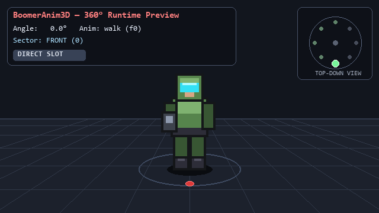

# BoomerAnim3D

A lightweight, strictly-typed **Godot 4** plugin providing a `BoomerAnimatedSprite3D` node for 1990s-style 2.5D boomer shooter characters, enemies, and props (inspired by *DOOM* 1993).

## Demo



## Documentation

Full trilingual user & technical documentation (Español / English / Português) is available in [`docs/BoomerAnim3D_Documentation.docx`](docs/BoomerAnim3D_Documentation.docx).

## Features

- **Visual 3×3 Inspector Direction Grid:** Click any of the 8 surrounding angles (`Front`, `Front Right`, `Right`, `Back Right`, `Back`, `Back Left`, `Left`, `Front Left`) or the center `Omni (1 Dir)` slot directly in the Inspector.
- **Native Godot SpriteFrames Workflow:** Selecting a cell loads that slot into Godot's native bottom **SpriteFrames** panel (preserving FPS, loop toggles, spritesheet slicing, and per-frame duration) while keeping the direction grid visible in the Inspector.
- **DOOM-Style 5-Direction Auto-Mirroring:** Enable `mirror_left_if_empty` to populate only 5 angles (`Front`, `Front Right`, `Right`, `Back Right`, `Back`) and automatically mirror the left side with `flip_h`.
- **Omnidirectional (`Omni`) Priority:** Place 1-direction animations such as `death`, `hurt`, `explode`, or static/animated props in the center `Omni` slot—if the active animation exists there with frames, it automatically overrides all 8 directional views.
- **Seamless Frame Continuity:** Rotating around an animated character switches directional `SpriteFrames` while preserving the exact `frame` index and `frame_progress`, so walk or attack cycles never reset mid-stride.
- **Boomer Shooter Defaults:** Automatically configures `BILLBOARD_FIXED_Y`, `TEXTURE_FILTER_NEAREST`, `ALPHA_CUT_DISCARD`, `pixels_per_meter` scaling, and `fullbright_animations` (disables shading for glowing attacks or muzzle flashes).
- **One-Click Animation Sync:** Copy animation names, FPS, and loop flags from the active direction to all other 7 directions without touching `Omni` or existing frames.

## Installation

### From Godot Asset Library
1. Open your Godot 4 project and go to the **AssetLib** tab.
2. Search for **BoomerAnim3D** and click **Download** → **Install**.
3. Go to **Project → Project Settings → Plugins** and enable **BoomerAnim3D**.

### Manual Installation
1. Copy `addons/boomer_anim_3d/` into your project's `res://addons/boomer_anim_3d/` directory.
2. Open **Project → Project Settings → Plugins** and set **BoomerAnim3D** to **Enabled**.

## Quick Start

1. Add a **`BoomerAnimatedSprite3D`** node as a child of your enemy or character (`CharacterBody3D` / `Node3D`).
   - By default, `orientation_node` automatically binds to the parent `Node3D` at runtime if left empty.
2. Select the `BoomerAnimatedSprite3D` node and use the **BoomerAnim3D — Direction Grid** at the top of the Inspector:
   - Click **Front** and add your animations (e.g. `walk`, `attack`) in the bottom **SpriteFrames** dock.
   - Click **Sync Animation Names to All 8 Directions** to pre-populate the animation list, FPS, and loop settings across the remaining directional slots.
   - Fill in the other directions (or just **Front Right**, **Right**, **Back Right**, and **Back** when `mirror_left_if_empty` is enabled).
   - Click **Omni (1 Dir)** for non-directional animations such as `death`.
3. Trigger animations from your character script using `play_anim()`:

```gdscript
extends CharacterBody3D

@onready var sprite: BoomerAnimatedSprite3D = $BoomerAnimatedSprite3D

func _ready() -> void:
	sprite.play_anim(&"walk")

func fire_weapon() -> void:
	sprite.play_anim(&"attack")

func die() -> void:
	# Plays from the Omni slot automatically if "death" has frames there.
	sprite.play_anim(&"death")
```

## Inspector Properties & API

| Property / Method | Type / Signature | Description |
| --- | --- | --- |
| `orientation_node` | `Node3D` | Reference node whose `-Z` / `+X` axes define facing (defaults to parent `Node3D`). |
| `initial_animation` | `StringName` | Animation started automatically in `_ready()`. |
| `mirror_left_if_empty` | `bool` | Mirrors right sectors (`3, 2, 1`) onto empty left sectors (`5, 6, 7`). |
| `pixels_per_meter` | `float` | Controls `pixel_size = 1.0 / pixels_per_meter`. |
| `fullbright_animations` | `Array[StringName]` | Animations listed here set `shaded = false`. |
| `play_anim(...)` | `(anim_name: StringName, custom_speed: float = 1.0, from_end: bool = false) -> void` | Plays directional or `Omni` animations and applies fullbright state. |
| `get_or_create_frames(...)` | `(dir: int) -> SpriteFrames` | Returns or initializes the `SpriteFrames` resource for a direction (`0..8`). |
| `has_configured_frames(...)` | `(dir: int) -> bool` | Returns `true` if the direction slot has at least one frame. |
| `sync_animation_names_from(...)` | `(source_dir: int) -> void` | Copies animation names, FPS, and loop flags to the other 7 directions. |
| `get_current_direction()` | `() -> int` | Returns the active `BoomerAnimatedSprite3D.Direction` index. |

## License

Released under the [MIT License](LICENSE).
